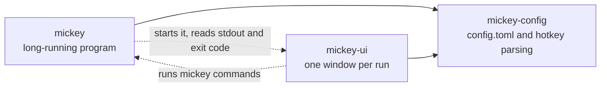
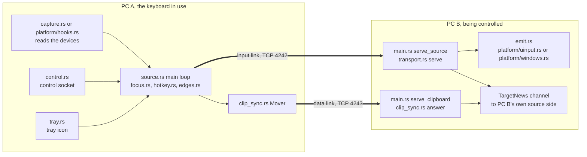

# Architecture

How Mickey is put together, for someone about to read the code. Words like
*peer*, *source*, *target* and *focus* mean what [CONTEXT.md](../CONTEXT.md)
says. The wire format is in [protocol.md](protocol.md); pairing, edges, the
switcher and the clipboard, step by step, are in [flows.md](flows.md).

## Three crates

| Crate | What it owns | Runs |
|---|---|---|
| `crates/mickey` | Everything that touches input, the network and the OS: capture, the focus state machine, the secure link, emitting input, discovery, the clipboard, the tray icon, the control socket | All day, as `mickey run` (or `mickey source` / `mickey target`) |
| `crates/mickey-config` | `config.toml`: parsing, defaults, the edits the settings window and `mickey` write back (`add_peer`, `set_position`, `set_hotkeys`), hotkey text such as `AltGr+RightShift+1` (`chord.rs`), and the text of `mickey peers` (`peers.rs`) | A library inside the other two |
| `crates/mickey-ui` | Every window, built with egui: the switcher, the settings, the pairing question, the clipboard history | Only while a window is on screen |

The GUI is a separate program on purpose: egui costs 90 to 125 MB while a
window is open (PRD 0003, *Discoveries*), and `mickey`, which holds the
keyboard, must stay small and must never hang because a window did.
`mickey-config` exists so both programs apply exactly the same rules to
`config.toml`.



The two programs never share memory. `mickey` starts `mickey-ui switcher`,
`mickey-ui pair` and the other windows as child processes (`window.rs`,
`trust.rs`) and reads the answer from their standard output and exit code.
The settings and history windows go the other way: they run `mickey peers`,
`mickey connect`, `mickey arranged` and similar commands, which talk to the
running Mickey over the control socket.

## One process, two sides

`mickey run` (`crates/mickey/src/main.rs`, `run_from_config`) reads
`[this_pc]` from `config.toml` and plays both roles in one process:

- **The source side**, `source::run` in `crates/mickey/src/source.rs`:
  captures this PC's keyboard and mouse, decides where they go, and keeps a
  link to every peer.
- **The target side**, `target` in `crates/mickey/src/main.rs`: listens for
  peers and turns what they send into real input on this PC.

Peers are symmetric: every PC runs both sides, so any keyboard can drive any
PC. `controls_others = false` or `controlled = false` turns one side off.
`mickey source` and `mickey target --listen` still run one side alone, as
in M0.

The two sides share three things: the list of trusted keys
(`trust::Shared`), the clipboard (`clipboard::Keeper`) and a channel of
`TargetNews`. Through that channel the target tells the source what peers
said to it: "a peer's keyboard came over" (for the tray dot), "a peer
placed itself on your desktop", "here is a peer's group map", "here are the
group's hotkeys".



Both arrows are encrypted with Noise. The input link carries tiny, frequent
messages (keys, motion, pings); the data link carries bulk payloads (the
clipboard, the group map, the switcher's cards) so that a 5 MB screenshot
never sits in front of a key press. PC B runs the same picture in the other
direction when its own keyboard is in use.

## Threads

Mickey uses plain `std::thread` and `std::sync::mpsc` channels; there is no
async runtime. The main loop of the source is the only place that decides
anything about focus; every other thread feeds it through one channel of
`Wake` values (`source.rs`), or talks to a link it owns.

| Thread | Started in | Does |
|---|---|---|
| Capture, one per device (Linux) | `capture::spawn_readers` | Blocks on `read_event`, turns raw evdev events into `InputEvent`s, sends them to the main loop |
| Hook thread and translator (Windows) | `platform/hooks.rs`, `input.rs` | A message loop for the low-level hooks; a second thread turns hook events into `InputEvent`s with evdev codes |
| Source main loop | `source::run` | Waits on the `Wake` channel, runs `Switcher`, sends to the focused peer, pings every second, publishes the status |
| Connect, one per peer | `connect_first`, `reconnect` | TCP connect, Noise handshake, pairing if needed, `Hello`; hands the link to the main loop. Retries every 5 s |
| Peer reader, one per connected peer | `read_peer` | Reads what the peer sends back (`Pong`, `Monitors`, `Leave`, `Refused`, `Picked`) |
| Mover | `clip_sync::Mover::start` | Owns every outgoing data link; moves the clipboard when the focus moves, sends the group map, hotkeys and switcher cards |
| Target accept loop | `main.rs` `target` | Accepts input links |
| Serve, one per connected source | `main.rs` `serve_source` | Pairing on this side, then `transport::serve`: decrypt, track held keys, emit |
| Data link accept, and one per data link | `main.rs` `serve_clipboard` | `clip_sync::answer`: answers `Ask`, writes received content, passes kinds 16 and up on |
| Switcher shown for a peer | `show_switcher_here` | Runs `mickey-ui switcher` and sends the pick back as `Picked` |
| Discovery, two | `discovery::start` | One broadcasts this PC every 3 s on UDP 4243, one listens and fills the table |
| Clipboard keeper | `clipboard::Keeper::start` | The only owner of the system clipboard in the process |
| Clipboard watch and history | `clip_watch.rs`, `history::record` | Notice every copy, add it to the in-memory history |
| Control socket, two | `control::Control::start` | One accepts requests, one pushes status lines to `follow` clients |
| Tray | `tray.rs`, `platform/tray.rs` | `ksni` on its own thread on Linux; a hidden window with a message loop on Windows |

Why so many threads: each one blocks on exactly one thing (a device, a
socket, a child process), so the main loop never waits on the network or a
window, and an offline peer or an open pairing window never holds up the
others.

## The platform layer

All `unsafe` code lives in `crates/mickey/src/platform/`, each block with a
`// SAFETY:` comment. The bindings are hand-written; there is no `libc`,
`evdev` or `windows-sys` crate.

| File | OS | What it wraps |
|---|---|---|
| `platform/linux.rs` | Linux | `ioctl` on `/dev/input/event*`: device names and capabilities, which keys are down, `EVIOCGRAB`. `Grab` releases the grab in `Drop` |
| `platform/uinput.rs` | Linux | `/dev/uinput`: a virtual keyboard and mouse, destroyed in `Drop` |
| `platform/windows.rs` | Windows | `SendInput`, `SetCursorPos`, `EnumDisplayMonitors`, the clipboard sequence number |
| `platform/hooks.rs` | Windows | `WH_KEYBOARD_LL` and `WH_MOUSE_LL` hooks, raw input, the invisible foreground window used while the focus is remote |
| `platform/tray.rs` | Windows | `Shell_NotifyIconW` and its popup menu |

Above that layer the code is safe and shared. `input.rs` gives the source
one `Input` type on both systems (open, start, grab, cursor), and `emit.rs`
gives the target one `Emitter`. Key codes are Linux evdev codes everywhere:
Windows translates its scan codes to evdev when capturing (`keymap.rs`,
used by `input.rs`) and back when emitting (`emit.rs`).

Two things are not in `platform/` because they need no `unsafe`: reading
the cursor and monitors on Linux goes through Hyprland's IPC socket
(`monitors.rs`), and the Linux tray uses the `ksni` crate.

## One key press, from capture to emit

PC A's keyboard is focused on PC B. The owner presses `A`:

```mermaid
sequenceDiagram
    autonumber
    participant Dev as Keyboard on PC A
    participant Cap as Capture thread, PC A
    participant Main as Source main loop, PC A
    participant Link as secure.rs Link
    participant Serve as serve_source thread, PC B
    participant Emit as Emitter, PC B
    Dev->>Cap: evdev event, or a hook callback on Windows
    Cap->>Main: Wake Input, Key code 30 pressed
    Main->>Main: Switcher handle, then Hotkey feed
    Note over Main: a hotkey's last key is held back here; modifiers go on at once
    Main->>Link: send Message Input Key
    Link->>Link: protocol encode, Noise seal, 16-byte tag
    Link->>Serve: 2-byte length and ciphertext over TCP
    Serve->>Serve: Noise open, protocol decode
    Serve->>Serve: HeldSet records key 30 as down
    Serve->>Emit: act with Effect Input
    Emit->>Emit: uinput write on Linux, SendInput on Windows
```

In code: `capture.rs` (`Translator::feed`) → `source.rs` (`Wake::Input`,
`switcher.handle`) → `focus.rs` (`Switcher::handle`) → `hotkey.rs`
(`Hotkey::feed`, which decides whether the key is forwarded now, later or
never) → `Action::Send` → `secure.rs` (`Link::send`) → `protocol.rs`
(`encode`). On the target: `transport.rs` (`serve`) → `held.rs`
(`HeldSet::set`) → `main.rs` (`serve_source`'s `output`) → `emit.rs`
(`Emitter::emit`).

The link itself does not allocate per event: `Link::send` and `Link::recv`
build and open frames in fixed arrays on the stack (`MAX_FRAME`), and
`Message` is `Copy`.

## The ways home

A grab that is never released locks the owner out of their own desktop
(CLAUDE.md, hard rule 8). These are the exits on `main`:

- **The grab is a guard.** `Grab` (Linux) and `Grabbed` (Windows) release
  the devices in `Drop`, so returning from `source::run` for any reason,
  `?` and panics included, gives them back. On Linux the kernel also drops
  the grab when the process dies.
- **The home hotkey**, `AltGr+RightShift+0` unless `config.toml` sets
  another one; the `next` hotkey with a single peer; with more peers,
  *This PC* in the switcher (`hotkey.rs`, `focus.rs`).
- **A peer that goes quiet loses the focus.** A failed send, or no answer
  for 4 s (`SILENT_LIMIT` in `source.rs`), drops the link and brings the
  focus home. Sends time out after 1 s (`WRITE_TIMEOUT` in `transport.rs`).
- **A target that cannot inject** (Windows, an elevated window in front)
  sends `Refused`, and the source brings the focus home.
- **The tray menu** (*This PC*) and `mickey home`.
- **On the target**, whatever the source still held down is released when
  the link ends, cleanly or not (`transport::serve`).
