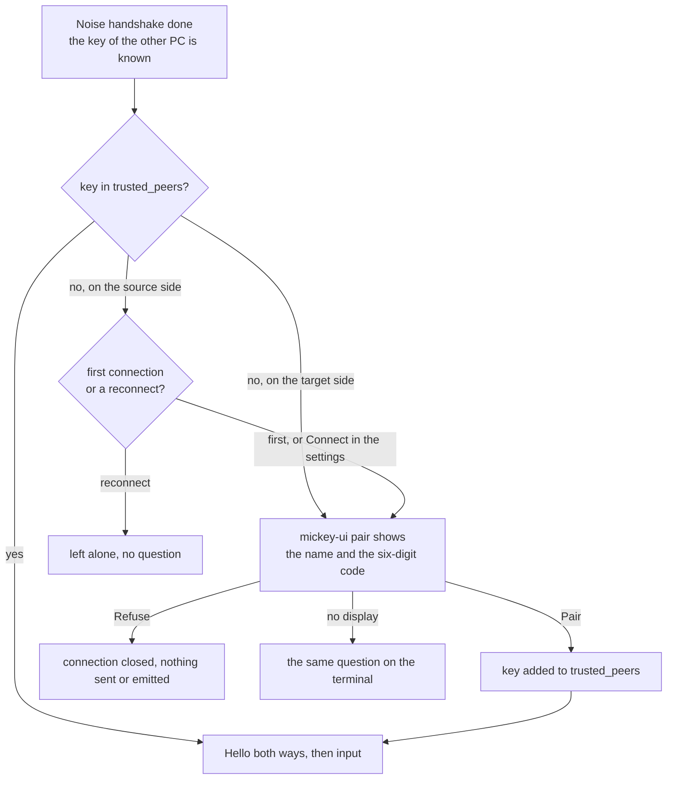
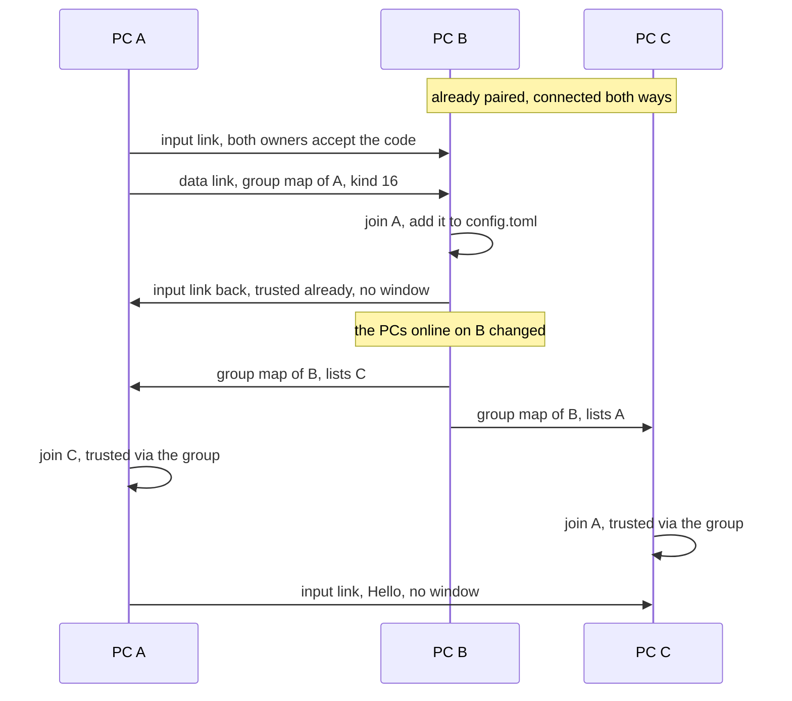
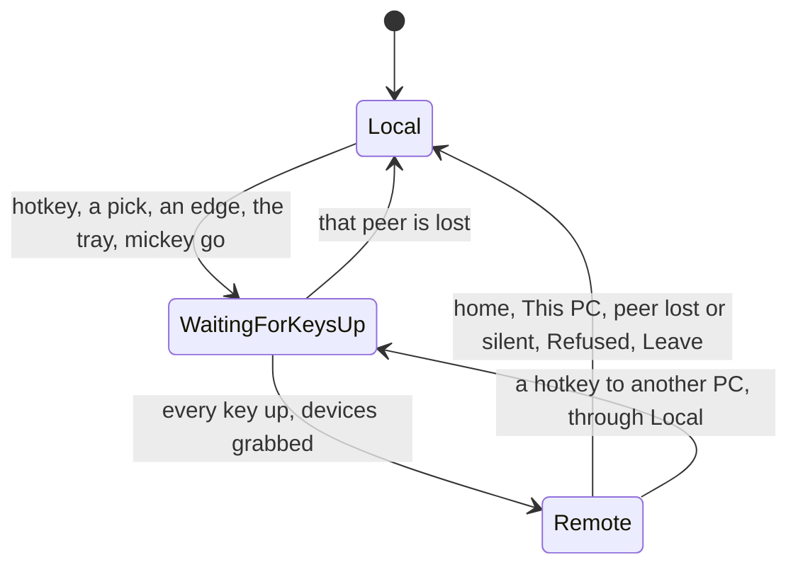
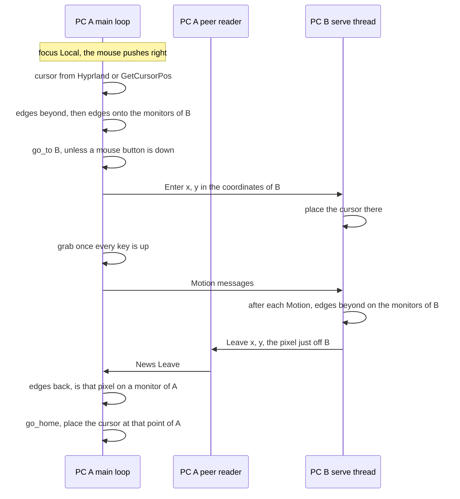
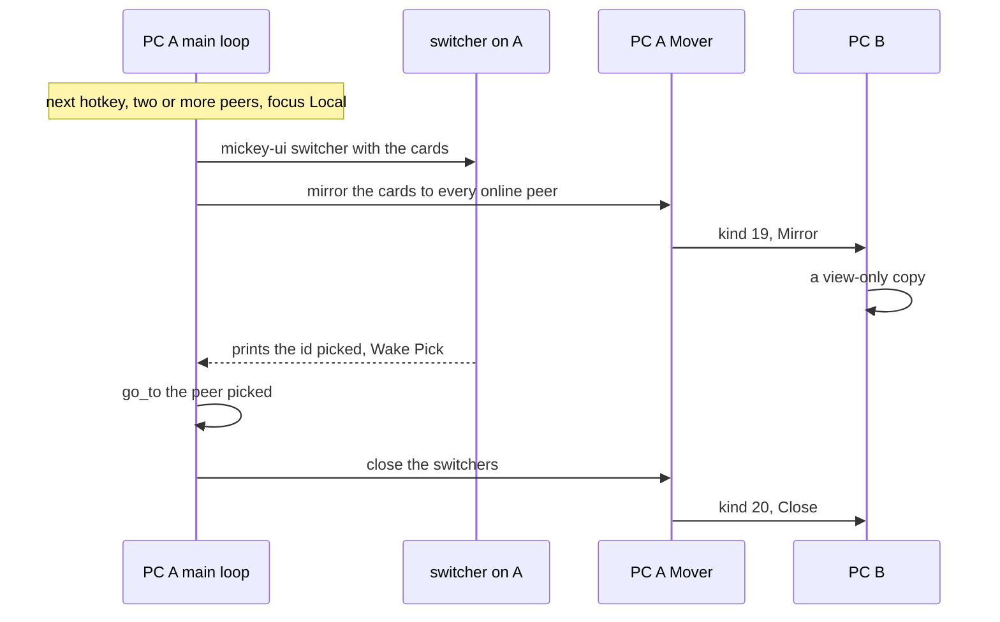
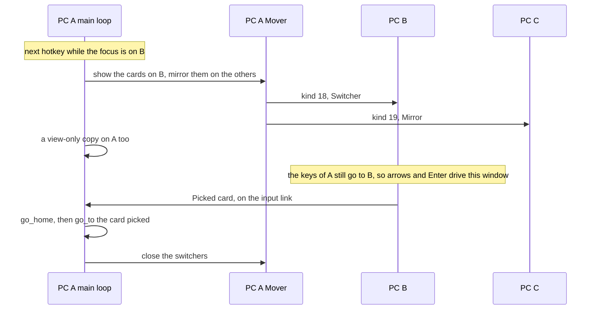
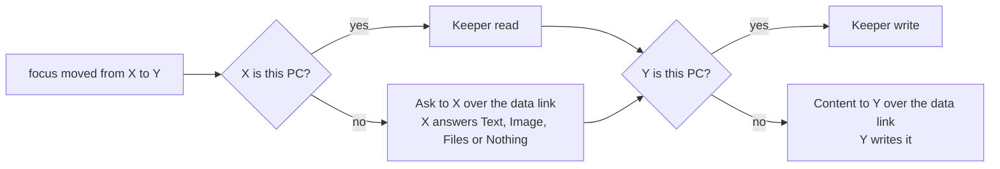
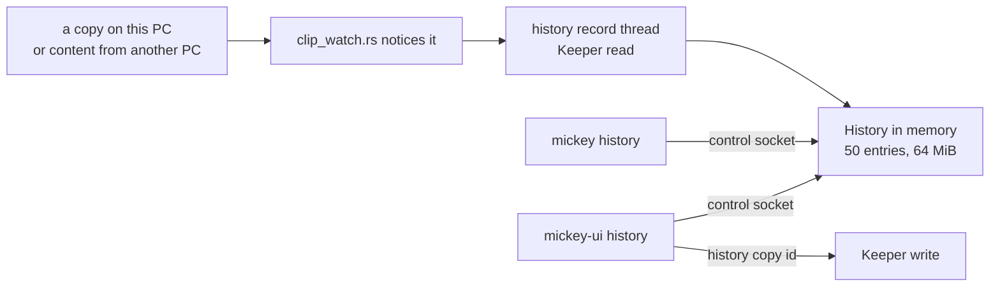

# Flows

The things Mickey does, one at a time, as they happen across PCs. The
pieces named here are described in [architecture.md](architecture.md), and
the messages in [protocol.md](protocol.md).

## Pairing

Two PCs talk only if each trusts the other's public key (`trust.rs`,
`trusted_peers` next to the identity). Trust is by key, never by address.

- **Who asks.** Both PCs show the window at the same time, with the same
  code (protocol.md, *The Noise handshake*). The source waits up to 90 s
  for the target's owner to answer.
- **Starting it.** The settings window lists the PCs heard on the LAN
  (`discovery.rs`). *Connect* runs `mickey connect <address> <name>`, which
  adds the PC to `config.toml` and connects (`Order::Connect` in
  `source.rs`). Listing a peer in `config.toml` by hand does the same at
  the next start.
- **Reconnects never ask** (`reconnect` in `source.rs`): they run in the
  background while the owner may be typing elsewhere.
- `mickey forget <fingerprint>` removes a key; that PC must pair again.

### Group trust

The owner decided that a PC the group introduces is trusted: a member
already trusted vouches for it (`group.rs`). Every source side sends its
**group map** (itself and every peer whose key it knows, with positions)
to every peer over the data link, when a data link opens and whenever the
set of PCs online changes. A PC that receives a map trusts each member,
adds the new ones to `config.toml` and connects to them without a window
(`join` in `source.rs`).

PC A pairs with PC B, which already knows PC C:

A map is in its sender's coordinates. `group::as_seen_by` moves each
position to the receiver's desktop: if the receiver sits at `m` on the
sender's desktop, a PC at `p` there is at `p - m` here.

## Focus

Where the keyboard and mouse go is one state machine, `Switcher` in
`focus.rs`, driven by the source's main loop:

`WaitingForKeysUp` exists because grabbing while a key is down leaves it
stuck down on the local desktop. The main loop checks every 10 ms and grabs
once nothing is pressed. Going home first releases, on the peer, every key
and button the source sent as pressed (`HeldSet` in `held.rs`).

### Hotkeys

`hotkey.rs` matches chords from `[hotkeys]` in `config.toml`; the text is
parsed by `mickey-config` (`chord.rs`). Defaults:

| Setting | Default | Does |
|---|---|---|
| `next` | `AltGr+RightShift` | One peer: go there, or come back. Two or more peers: open the switcher |
| `home` | `AltGr+RightShift+0` | Back to this PC |
| `switcher` | `AltGr+Up` | Open the switcher |
| `forward`, `back` | `AltGr+Right`, `AltGr+Left` | The next or previous PC in the list, this PC included, skipping offline ones |
| `double_tap` | `RightShift` twice within 400 ms | Same as `forward`; `""` turns it off |
| `[[peer]] hotkey` | `AltGr+RightShift+1` to `+9` | Straight to the first nine peers |

A hotkey fires when all its keys are released and nothing else was pressed
in between. While the focus is remote, modifiers and the double-tap key
reach the target at once (a game holding Ctrl gets it when pressed); only a
chord's last key, such as the `1` of `AltGr+RightShift+1`, is held back. If
the hotkey completes, the target never sees that key; if another key comes
first, it is sent after all, so AltGr+Q and Shift+1 still type. When the owner saves the
hotkeys in the settings, they are sent to every peer (kind 17), so the
whole group uses the same keys.

**The way home.** On `main` it is the `home` hotkey (configurable), or
`next` with one peer, or *This PC* in the switcher, the tray or
`mickey home`; a peer that stops answering for 4 s, refuses the input or
disconnects also brings the focus home (architecture.md, *The ways home*).

### Screen edges

Each peer may have a `position` in `config.toml`: where its point 0,0 sits
on this PC's desktop (PRD 0005). The settings window sets it by dragging
(`layout.rs`, `snap.rs` in `mickey-ui`), then runs `mickey arranged`, which
sends `Arrange` to each placed peer so it saves the mirror position.

The source knows its own cursor, so it notices leaving; the target knows
its own, acceleration included, so it notices coming back (`edges.rs`,
`transport::serve`). On Linux the cursor comes from Hyprland's IPC, the
only Linux desktop supported for edges so far (`monitors.rs`). When a
source's keyboard leaves a target (`Focus` with `here` 0), the target parks
its cursor in the bottom-right corner (`emit::park`), and puts it back when
that keyboard returns.

## The switcher, on every PC

The switcher is `mickey-ui switcher`, one card per PC (`choice.rs`). It
shows up on the PC the owner is looking at, which is the PC the keyboard is
on, and a view-only copy shows on every other online PC (PRD 0007). Each PC
places it in its own corner (`[interface] switcher_position`).

With the focus on this PC:

With the focus on PC B, the window opens on B instead:

The hotkey pressed again while switchers are open closes them all. If
`mickey-ui` cannot run, the hotkey goes to the first online peer instead.
The cards carry ids, not positions in the list: 0 is the PC that sent them
and `i + 1` its peer `i`, so sorting them (`Interface::switcher_sort`)
never changes what a pick means.

## The clipboard

The clipboard follows the keyboard (PRD 0011): when the focus moves from X
to Y, what is copied on X is put on Y. Nothing crosses on every copy. The
`Mover` thread does it (`clip_sync.rs`, `carry`), over the data links:

- When X answers `Nothing`, or its data link fails, nothing is written.
- `clipboard.rs` reads and writes through `arboard`: Wayland data-control,
  X11, Windows. One `Keeper` thread owns it, because on Wayland and X11 the
  copied data lives only while its owner does.
- Images cross as PNG; files cross whole, at most 60 MiB, and land in a
  fresh folder under Mickey's cache, the last five transfers kept
  (`received.rs`).
- What is copied may be a password: it is never logged, only its kind and
  size.

### History

`mickey run` keeps the recent copies made on this PC, including what
arrived from other PCs, in memory only, never on disk (`history.rs`).

`clip_watch.rs` notices copies without reading the clipboard over and
over: Wayland selection events, the Windows clipboard counter, or else the
text compared once a second. Copying the same thing again moves it to the
top. The history window searches the entries, and picking one runs
`mickey history copy <id>`, which puts it back in the clipboard.
