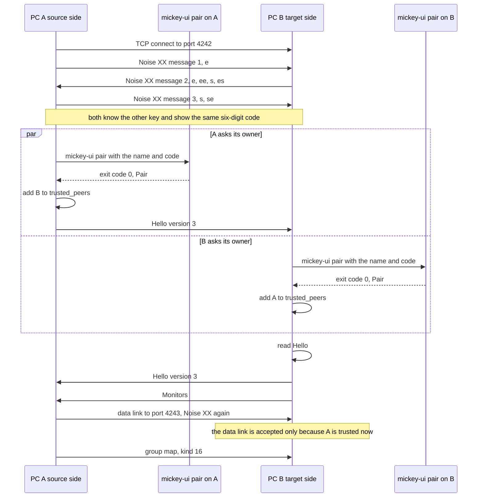
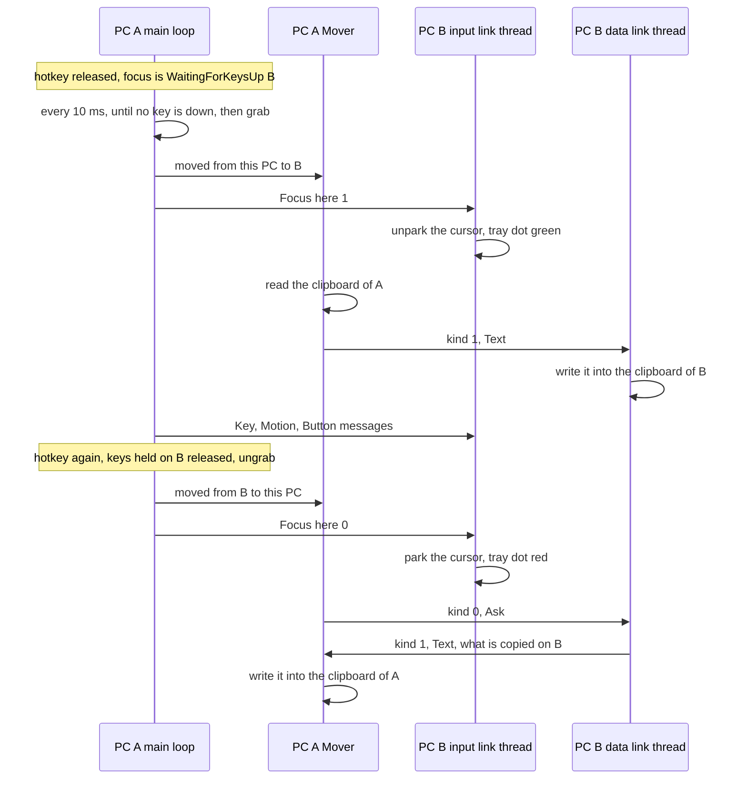

# Protocol

What crosses the network between two Mickeys, byte by byte. The threads
that send and receive it are in [architecture.md](architecture.md); what
happens around it (pairing windows, edges, the switcher) is in
[flows.md](flows.md).

## Four channels

| Channel | Transport | Port | Opened by | Carries | Code |
|---|---|---|---|---|---|
| Input link | TCP, Noise | `[this_pc] listen`, 4242 by default | The source side | Keys, motion, pings, focus, edges | `transport.rs`, `secure.rs`, `protocol.rs` |
| Data link | TCP, Noise | The input port + 1 (4243) | The source side, once its input link is up | Clipboard, group map, hotkeys, switcher cards | `transport.rs`, `secure.rs`, `clip_wire.rs`, `group.rs` |
| Discovery | UDP broadcast | 4243 | Everyone, every 3 s | Name, port and public key | `discovery.rs` |
| Audio | UDP, sealed datagrams | The input port + 2 (4244) | A PC sending its sound to the PC that listens | 5 ms of sound each | `audio.rs`, `audio_wire.rs` |

TCP 4243 and UDP 4243 do not collide: TCP and UDP ports are separate.

Every PC runs a source side and a target side, so two paired PCs may hold
up to four TCP connections: an input link and a data link in each
direction. Numbers are big-endian everywhere.

## The input link

### Connecting

`transport::connect` opens TCP with a 2 s timeout, turns on `TCP_NODELAY`
(so the kernel never holds a key press back to batch it) and sets a 1 s
write timeout (a target that stops reading can never keep the source's
keyboard grabbed: the send fails and the focus comes home).

### The Noise handshake

Right after TCP connects, before any Mickey message, both sides run
`Noise_XX_25519_ChaChaPoly_BLAKE2s` through the `snow` crate (`secure.rs`,
`Link::initiate` and `Link::respond`). The static key of each side is its
identity (`identity.rs`): an X25519 key pair kept in the user's data
folder. The three handshake messages are:

```text
source -> target   e
target -> source   e, ee, s, es
source -> target   s, se
```

After them each side knows the other's public key, proven by the
handshake, and both hold the same handshake hash. The whole handshake
must finish within 5 s, however its bytes trickle in, or the peer is
dropped; each port takes at most 32 connections at once, paired or not
(`main.rs`), so nobody can use up its threads. The handshake carries no payload: who the
peer is comes only from its key, which `trust.rs` looks up in
`trusted_peers` (a peer is trusted by its key, never by its address).

**The pairing code** is six digits from the handshake hash: its first four
bytes as a `u32`, modulo 1 000 000, shown as `042 917` (`code_from`). The
hash covers both static keys and both fresh ephemeral keys, so a machine in
the middle, which runs two handshakes with its own keys, makes the two PCs
show different codes. Every connection gets a new code.

### Framing

TCP delivers a stream of bytes, not messages, so each Noise message is
preceded by its length:

```text
[len_hi] [len_lo] [Noise message: ciphertext + 16-byte tag]
```

On the input link a Noise message longer than 256 bytes is refused
(`MAX_NOISE_MESSAGE`): the longest Mickey message is 146 bytes sealed. A
message that was changed, replayed, dropped or reordered fails to decrypt
(Noise counts messages), and the link closes.

Inside each encrypted message is one **frame body**: a type byte and its
payload. `protocol::encode` also writes a one-byte length in front, left
from M0's plaintext link; `Link::send` encrypts everything after it.

```text
[type] [payload...]
```

### Messages

The numbers are the constants in `protocol.rs`. S is the source side (the
PC whose keyboard is in use), T the target side.

| # | Message | Direction | Payload | Meaning |
|---|---|---|---|---|
| 1 | `Hello` | both | `version: u8` | First message each way; see below |
| 2 | `Input(Key)` | S → T | `code: u16`, `pressed: u8` (0 or 1) | A key, as a Linux evdev code |
| 3 | `Input(Button)` | S → T | `code: u16`, `pressed: u8` | A mouse button, evdev code (`0x110` is left) |
| 4 | `Input(Motion)` | S → T | `dx: i32`, `dy: i32` | Relative motion |
| 5 | `Input(Scroll)` | S → T | `vertical: i32`, `horizontal: i32` | Hi-res wheel units, 120 per notch |
| 6 | `ReleaseAll` | S → T | none | Release everything held. Decoded and obeyed by the target; the source on `main` sends one release per held key instead |
| 7 | `Ping` | S → T | `id: u32` | Every second. The id is the send time in µs, so a `Pong` gives the round trip with no table (`latency.rs`) |
| 8 | `Pong` | T → S | `id: u32` | The same id back |
| 9 | `Monitors` | T → S | `count: u8`, then `x, y, width, height: i32` per monitor, at most 8 | The target's monitors, sent right after its `Hello` |
| 10 | `Enter` | S → T | `x: i32`, `y: i32` | The cursor crossed onto your desktop here: place it |
| 11 | `Leave` | T → S | `x: i32`, `y: i32` | Your cursor pushes off my desktop onto this pixel (just off my monitors). Sent once per push |
| 12 | `Focus` | S → T | `here: u8` (0 or 1) | My keyboard and mouse now control you, or no longer do (the tray dot, cursor parking) |
| 13 | `Arrange` | S → T | `x: i32`, `y: i32` | On your desktop I sit at this point; sent after the owner places PCs |
| 14 | `Refused` | T → S | none | My system refused the input (Windows, an elevated window in front); take the focus back. At most once a second |
| 15 | `Picked` | T → S | `card: u8` | The card picked in the switcher shown on me: 0 is you, `i + 1` your peer `i`, 255 none |

Decoding never panics: an unknown type, a payload of the wrong length or a
boolean that is not 0 or 1 is a `DecodeError`, which closes the link.

### Hello and the version

`VERSION` is 3 (`protocol.rs`): 2 added the secure link, 3 added
`Monitors`, `Enter`, `Leave` and `Focus`.

1. The source finishes the handshake and checks the target's key (pairing,
   if it is new). Until then it sends nothing at all.
2. It sends `Hello { version: 3 }` and waits up to 90 s for the answer
   (`transport::hello`), long enough for the target's owner to answer a
   pairing window.
3. The target checks the source's key the same way, then reads the
   `Hello` (`transport::serve`). It answers `Hello` only once it trusts the
   source, then sends its `Monitors`.

A different version on either side is an error that names both versions.
Anything other than `Hello` first, or a second `Hello`, closes the link.
When the link ends, cleanly or not, the target releases every key and
button the source still held there.

## The data link

The source side opens it in the background once the input link is up
(`open_data_link` in `source.rs`): TCP to the input port + 1, then the same
Noise `XX` handshake with the same identities. The source keeps it only if
it answers with the key of the input link just opened to that PC: whoever
took over the address could otherwise answer only this port and get the
clipboard and the group map. The target side (`transport::accept_data`)
refuses any key that is not already trusted: a data link never asks to
pair. Writes may take 10 s here (megabytes), not 1 s, and the `Mover`
drops a link that stays silent for 10 s in the middle of an answer.

All data links of a source are owned by one thread, the `Mover`
(`clip_sync.rs`); on the target each data link has its own thread running
`clip_sync::answer`.

### Bulk payloads

One payload can be up to 64 MiB (`MAX_BULK`), far over a Noise message's
65 535 bytes, so `Link::send_bulk` splits it:

```text
Noise message 1:      payload length, u32
Noise messages 2...:  the payload, at most 65 519 bytes each (65 535 with the tag)
```

Each Noise message still has its own 2-byte length in front. The receiver
refuses a length over 64 MiB and pieces that do not add up to it.

### Payload kinds

The first byte of each payload says what it is. Kinds below 16 are the
clipboard's (`clip_wire.rs`); 16 and up are passed to the target's
`group` handler in `main.rs` (`serve_clipboard`).

| Kind | Name | Body | Sent |
|---|---|---|---|
| 0 | `Ask` | none | S → T: send me what is copied on your PC |
| 1 | `Text` | UTF-8 | Either way: the answer to `Ask`, or content put on the PC the keyboard went to |
| 2 | `Image` | PNG, 8-bit RGBA | As `Text`. A received PNG may unpack to at most 256 MiB |
| 3 | `Nothing` | none | T → S: nothing Mickey carries is copied |
| 4 | `Files` | `count: u32`, then per file `name length: u16`, name, `size: u64`, bytes | As `Text`. At most 60 MiB in total; a name that could leave the folder is refused (`received.rs`) |
| 16 | Group map | text, one PC per line | S → T, on every new data link and when the PCs online change |
| 17 | Hotkeys | the `[hotkeys]` lines of `config.toml` | S → T, after the owner saves them |
| 18 | Switcher | the focused card, then one card per line | S → T: show the switcher here, the owner is looking at you |
| 19 | Mirror | the same cards | S → T: show a copy that only looks |
| 20 | Close | none | S → T: a pick was made, close the switcher or copy shown for me |
| 21 | Audio | the shared `[audio]` lines: `listener`, `volumes`, `muted`, `since` | S → T, on every new data link and after the owner changes them; taken only if newer than the receiver's (`since`) |
| 22 | Audio key | a stream's id and key, in hex | S → T, to the PC that listens, when sending starts and every 2 s while it lasts |

A group map line is `<public key, 64 hex>`, `<name>`, `<ip:port>` (or
`:port` for the sender itself) and `<x,y>` or `-`, separated by tabs
(`group.rs`). A switcher card is `<id>=online:<name>` or
`<id>=offline:<name>`; id 0 is the sending PC, `i + 1` its peer `i`
(`switcher_cards` in `source.rs`). Only `Ask` gets a reply.

## Audio datagrams

Shared audio (PRD 0012) does not ride the data link: a lost or late piece
of sound must cost 5 ms, never stall what follows, which TCP would do.
Each datagram is 989 bytes (`audio_wire.rs`):

| Bytes | Field |
|---|---|
| 1 | Version, 1 |
| 4 | Stream id |
| 8 | Counter: 0, 1, 2… per datagram |
| 976 | 5 ms of 48 kHz stereo 16-bit PCM (960 bytes) sealed with ChaCha20-Poly1305, the counter as the nonce, the 13 bytes above as associated data (16 bytes of tag) |

The key is not the data link's: the sending PC picks a random stream id
and key and hands them to the listener as a kind 22 payload over its data
link, which is already encrypted and authenticated. The listener plays a
datagram only if its stream id has a key, it comes from that data link's
address, it opens, and its counter is new and no more than 64 behind the
newest (a replay or something too late is dropped). Silence is not sent.
On the listener each sending PC has a jitter buffer (`jitter.rs`): it
starts playing with 10 ms in hand, holds more when datagrams come late,
and gives it back after 10 s of calm.

## Discovery

Every Mickey started with `mickey run` broadcasts this packet to UDP 4243
every 3 s, and answers each PC it hears directly, at most every 3 s (a
broadcast can leave by the wrong network adapter):

```text
"MKY1" | port: u16 | public key: 32 bytes | name length: u8 | name (UTF-8, at most 64)
```

Nothing in it is secret and nothing is trusted because of it: it only
fills the "PCs found" list (`mickey discover`, the settings window) and
names a PC in the pairing window. A PC not heard for 10 s leaves the list.

## Connect and pair

PC A's source side connects to PC B for the first time:



A key that is already trusted skips both windows. If either owner refuses,
that side closes the connection and nothing is ever emitted. Without a
display, `mickey-ui pair` exits with 2 and the question goes to the
terminal (`trust.rs`).

## A focus switch, with the clipboard

The owner copies some text on PC A, sends the keyboard to PC B with the
hotkey, copies something on B and comes back:



The clipboard moves on the Mover's thread, so a big image never delays the
first keys on B; it may arrive a moment after them. Going straight from B
to another peer C passes through this PC: B's clipboard comes to A, then
goes from A to C.
