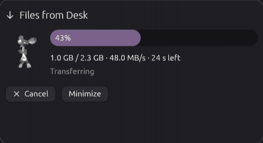
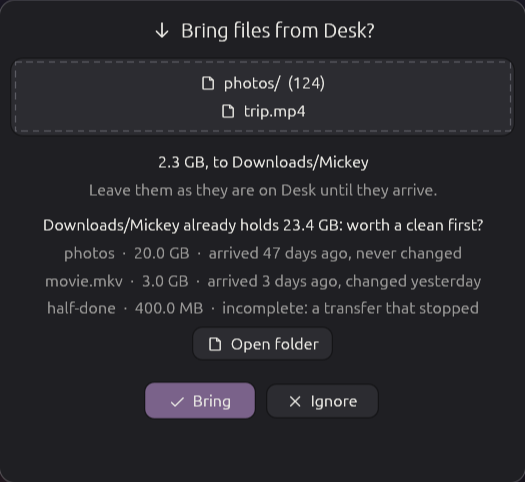
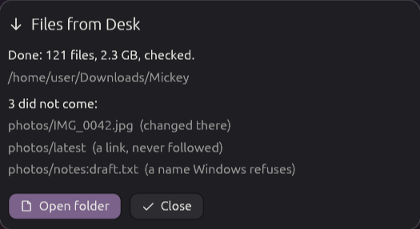
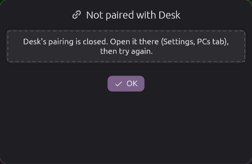

## Copy a folder on one PC, paste it on another

Files and whole folders of any size now cross with plain copy and paste. Copy them on one PC, move the keyboard to another, press Ctrl+V. They stream over the encrypted link, each file checked with BLAKE3, and are pasted only once all are there.

- **Big copies ask first.** Over 1 GB (you can change this in Settings > General) a small window asks whether to bring them, into `Downloads/Mickey`. It also says when that folder is worth a clean, and how old each thing in it is. Mickey never deletes what you brought.

  

- **It never fills your disk.** A free-space margin is kept, and a transfer that would not fit says so before it starts.
- **It goes on where it stopped.** A broken transfer (the network, a sleeping PC, Cancel) resumes at the exact byte the next time the keyboard crosses.
- **Transfers from one PC take turns**, and one waiting its turn says so.
- **You see what did not come, and why:** a file that changed meanwhile, a link, a name Windows refuses.

  

- **On Windows, files from your own PCs are not treated as from the Internet**, so SmartScreen and Office's Protected View do not warn about them. Defender still scans every file, and Settings > General can bring the warnings back.

With a firewall on, let in **TCP 4244**.

## The clipboard

- **Only when you ask, if you want.** A new choice in Settings > General keeps the clipboard where it is when the keyboard moves. Press **AltGr + Right Shift + C** on the PC you went to, to bring what you copied on the one you left.

  
- **What you copied arrives faster.** Each crossing no longer waits about a tenth of a second for the network.
- **An image is no longer sent again on every crossing**, only when something new is copied. Thanks to @wendelmax, who found it.
- **Fewer lost copies.** A copy that reached a PC the keyboard had already left, or passed through a third PC, could be lost; it is not any more.

## Sound

- **Shared sound stays in step with what you see.** It used to arrive up to a third of a second late on Windows, and click now and then. The PC that listens now plays a hair faster or slower, never heard, so the delay holds at about 25 ms however the two PCs' clocks run. Measured both ways between Linux and Windows with a test tone. Thanks to Thiago (@zednaked), whose note on audio clock drift made us measure it.

## Pairing

- **A code never shows on one screen only.** When the other PC's pairing is closed, or its owner says no, the code window closes at once, and a window says why and what to do.

  

## Windows

- **Mickey starts at logon without a script.** The way it used to start is what Windows Defender mistook for malware on some new installs.
